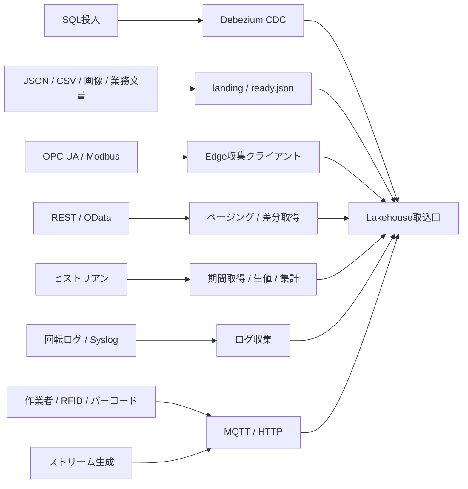

# データソースの配置・収集構成例

| 種類 | リポジトリ | 画面ポート | 収集方法 |
| --- | --- | --- | --- |
| SQL | factory-sql-data-loader | 3560 | DBをCDC/クエリで取得 |
| ファイル | factory-file-generator | 3561 | landingのready.jsonを起点に取得 |
| ストリーム | factory-stream-simulator | 3562 | MQTT/Kafka/HTTP等 |
| 設備 | factory-equipment-simulator | 3640 | OPC UA 3645 / Modbus TCP 3646 |
| 業務API | factory-api-simulator | 3641 | REST / ODataサブセット |
| ヒストリアン | factory-historian-simulator | 3642 | 履歴REST / 期間指定 / 集計 |
| ログ | factory-log-simulator | 3643 | 回転ファイル / Syslog UDP・TCP・TLS |
| 識別 | factory-identification-simulator | 3644 | RFID・作業者イベント / MQTT・HTTP |

各アプリは独立したGitリポジトリ・設定・永続データとして配置できます。この文書は汎用的な構成例であり、特定環境の稼働状況・アドレス・ネットワーク割り当てを示すものではありません。上表は設定例のポートです。ComposeのBIND_IPは既定で127.0.0.1（loopback）にbindし、管理画面・操作APIを外部へ公開しません。公開Compose単体は通常の独立ネットワークで起動します。収集先を説明する場合は`<SIMULATOR_HOST>`などのプレースホルダーを使い、実アドレスと資格情報はリポジトリ外の非公開設定へ保存してください。
管理画面・操作APIはログイン不要です。BIND_IPを変更して外部から利用する場合は、認証・TLS・アクセス制限を別途設計してください。この構成例は外部公開を推奨するものではありません。

収集クライアント・Edge GatewayとCloudflare側の取り込みは別コンポーネントです。この追加はソースの模擬までを実装し、Cloudflareへの本番取り込みやAI/BIを自動配備していません。

横断試験にはequipment_id / lot_id / work_order_id等の業務キーと、event_time / 受信時刻 / event_idを分けて設定してください。各アプリの既定プリセットが全て同じ業務トランザクションに自動連動するわけではありません。共通パラメーター・同じseed・同じキー規則で揃え、異常の正解ラベルは別の検証結果に保持するのが適しています。
