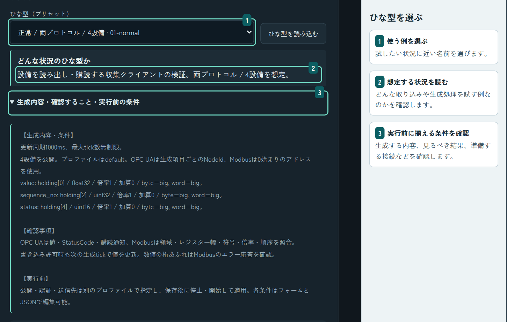
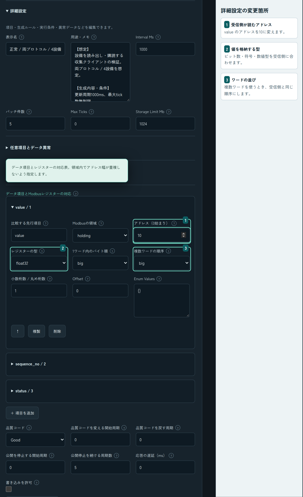
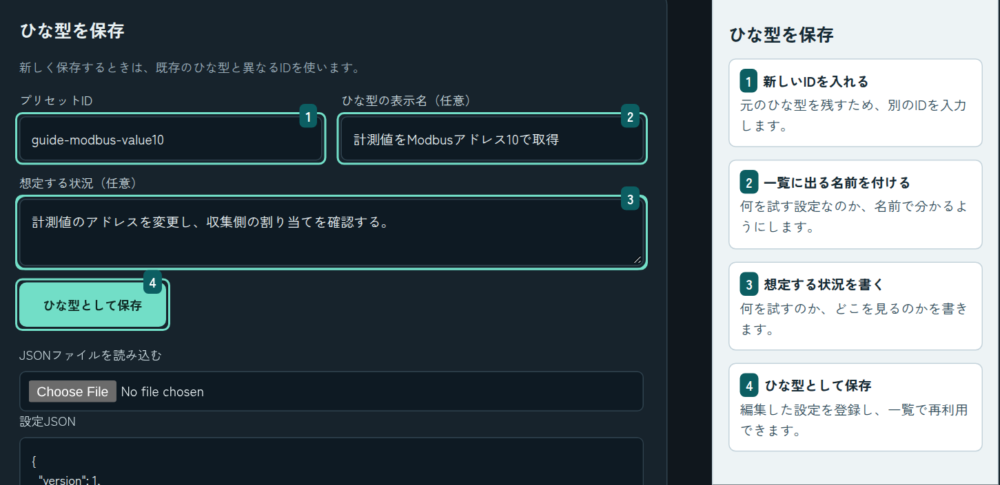

# 設備シミュレーターのひな型と詳細設定

ひな型（プリセット）は、生成するデータの項目・件数・書式や、再現したい異常をまとめた設定です。試したい状況に近いひな型を読み込み、見本を確認してから必要な設定を変えます。公開、書き込み、送信を始めるときは、画面の実行ボタンを使います。

## ひな型を選ぶ

**正常 / 両プロトコル / 4設備（01-normal）** を例にします。

OPC UAやModbusで計測値を取り込む収集クライアントを試す場面です。元の例は4台の設備を模擬し、計測値 value をModbusの保持レジスター0に割り当てます。

「基本設定」でひな型を選び、「ひな型を読み込む」を押します。

「どんな状況のひな型か」で用途を確認し、「生成内容・確認すること・実行前の条件」で作るデータや準備を読みます。

「異常 / 固着（15-anomaly）」は読取り自体は成功しても値が更新されない状況を試す例です。

全ひな型の用途は[プリセット一覧](../presets/README.md)を参照してください。

## 詳細設定を変更して見本を見る

「詳細設定 → 設備・レジスターの設定 → value / 1」を開き、「アドレス（0始まり）」を0から10にします。シーケンス番号と状態の割り当てはそのまま使います。

| 設定 | 変えられること |
| --- | --- |
| データ項目とModbusレジスターの対応 | 生成する項目を、Modbusの領域、アドレス、型へ割り当てます。 |
| アドレス（0始まり） | 受信側と起点を揃えます。32ビットの値は2レジスター分を使います。 |
| バイト順・ワード順 | 複数バイトの並びを受信側に合わせます。変換後の値は見本で照合できます。 |

**見本での確認**　「読取マッピングを見る」で value のアドレスが10となり、変換されたレジスター値が表示されることを確認します。実際のクライアント疎通は隔離した環境で公開後に確認します。

## 自分のひな型を作って保存する

1. 上の例で編集した設定を残すには、「設定を保存・JSONで編集」を押します。今の設定がJSON欄に入った保存画面が開きます。
2. 「プリセットID」に `guide-modbus-value10` のような新しいIDを入力します。半角英数字、ハイフン、下線が使えます。同じIDで保存すると、そのひな型を更新します。
3. 必要に応じて表示名と想定する状況を入力し、「ひな型として保存」を押します。画面で編集した設定は、JSON欄を書き直さず保存できます。
4. 生成画面の「基本設定」に戻り、新しく保存したIDを選んで「ひな型を読み込む」を押します。見本を出し、変更した条件が戻っていることを確認します。

たとえば収集側のワード順を確認するひな型を作る場合は、使っているレジスターの行を開き、「レジスターの型」と「複数ワードの順序」を収集側の仕様に揃えます。プレビューに表示されるアドレスと型を確認し、何番地のどの型を読む試験かが分かる名前で保存します。

共有するひな型には「計測値をModbusアドレス10で取得」のような表示名と、「計測値のアドレスを変更し、収集側の割り当てを確認する。」のような用途を書いておくと、次の人が選びやすくなります。接続先と認証は「公開・出力設定」で管理します。ひな型を別環境で使う場合は「JSONを書き出す」で持ち出し、利用先で接続設定を選び直します。

[操作ガイドに戻る](../README.md#操作ガイド)
