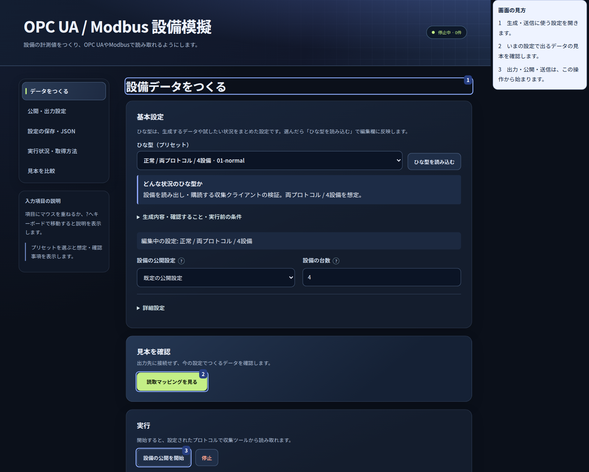

# 設備シミュレーター 操作マニュアル

OPC UAクライアントやModbus TCPポーラーが設備の値を読み取れるか検証します。設備の疑似値を周期更新し、収集側が接続して読み取る方式です。

## 最初に試すこと

**設備の値をModbus TCPかOPC UAで1項目読む**。見本に出たレジスターまたはノードから、収集クライアントで疑似値を取得できます。

[Docker Compose導入手順](vm-compose.md)で準備し、VMで `http://127.0.0.1:3640/` を開きます。

Modbusのレジスターは値の番地、OPC UAのノードは値や設備を識別する項目です。接続手順を切り分けるには、片方のプロトコルから始めます。

1. 「基本設定」で「正常 / 両プロトコル / 4設備」のひな型を読み込みます。「公開・出力設定」で最初に試す公開方式を確認します。
2. 「読取マッピングを見る」を押し、読みたい行のModbusアドレス、またはOPC UAノードIDを控えます。Modbusの値が複数ワードの場合は「詳細設定」でワード順も確認します。
3. 「設備の公開を開始」を押します。「実行状況・取得方法」でアドレス、Modbusの端末ID、OPC UAのnamespace URIを確認し、手元の収集クライアントで1項目を読みます。
4. 試験が終わったら「実行状況・取得方法」で停止します。停止後はリスナーの提供も終わります。

## よくある質問

### Modbusの4xxxx表記をそのまま使えますか？

画面のアドレスは0始まりです。クライアントが4xxxx表記を使う場合は、そのクライアントの入力方式を確認します。

### Web画面が開くのに設備の値を読めません

公開ボタンを押したか、選択したプロトコル、公開ポート、接続元からの経路を確認します。

### OPC UAでnamespaceの番号が違います

クライアントでnamespace URIから番号を解決して、見本のノードを指定します。

## 停止と再起動

「実行状況・取得方法」で停止します。起動直後は待機し、ポートの公開設定があってもデータを返すリスナーは手動開始を待ちます。

## 想定した結果が出ないとき

Modbusクライアントの4xxxx表記と0始まりアドレスを照合してください。OPC UAでnamespaceの番号が変わる場合はURIからクライアントで解決します。

## 通信番地の読み方

| 例 | 値の位置 | クライアントで照合すること |
| --- | --- | --- |
| OPC UA | 公開後のnamespace URIと見本のノードID | アプリの表示とクライアントで解決した番号を照合します。 |
| Modbus Holding Register 0 | 0始まりのワード番地 | 40001を起点にするクライアントでは0番地に対応します。 |
| float32を番地0から配置 | 0番地と1番地に1語ずつ | 読取語数2、バイト順、ワード順を照合します。 |
| 値が欠測・未知のenum | その数値割当を含む要求が例外4になります。 | 別の番地への要求と分けて、障害と復旧を確認します。 |

OPC UAのみを使う場合は、公開設定でModbusを無効にします。

## 次に読む

- [ひな型を選ぶ・作る](preset-guide.md)
- [設定リファレンス](settings-reference.md)
- [JSONの書き方](template-guide.md)
- [APIの使い方](api-guide.md)
- [用語集](glossary.md)
